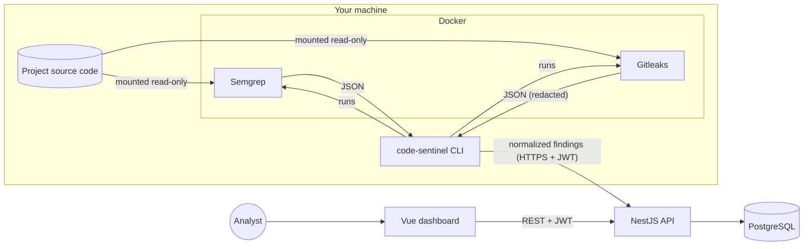
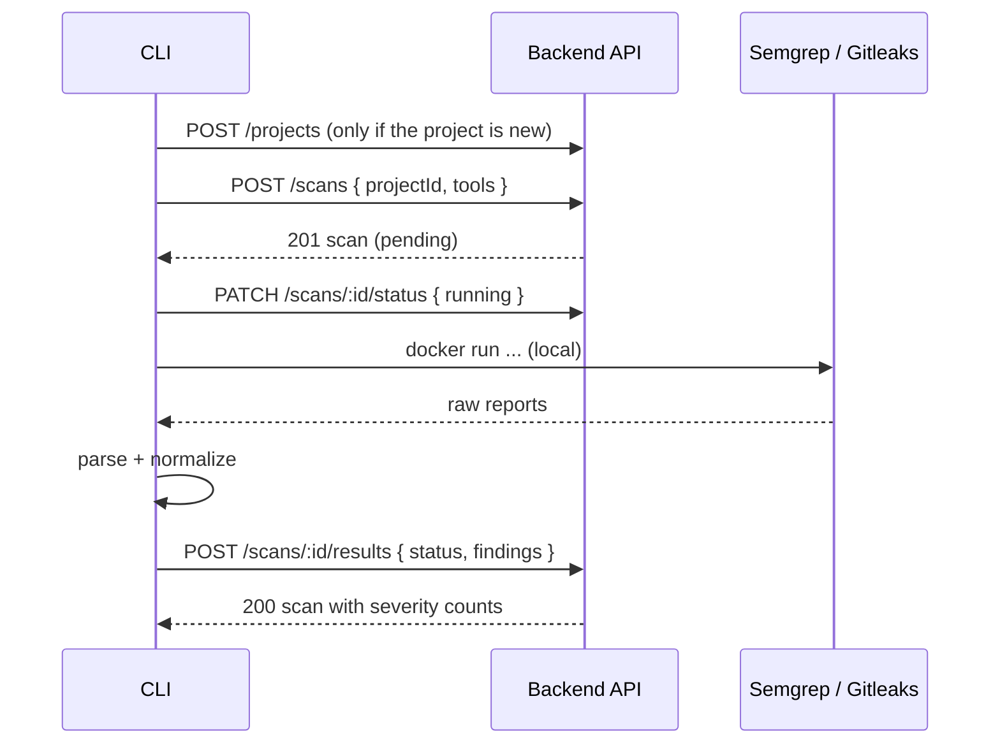

<div align="center">

# Code Sentinel

**Local-first AppSec platform that runs security scanners on your machine and centralizes their findings in one dashboard.**

[](https://github.com/AmazingJuan/code-sentinel/actions/workflows/ci.yml)
[](https://www.npmjs.com/package/@amazingwalin/code-sentinel-cli)


[Quick start](#quick-start) · [CLI](#using-the-cli) · [Dashboard](#using-the-dashboard) · [Development](#local-development) · [Configuration](#configuration-reference) · [Troubleshooting](#troubleshooting)

</div>

---

## Table of contents

- [What is Code Sentinel?](#what-is-code-sentinel)
- [Features](#features)
- [How it works](#how-it-works)
- [Choose your path](#choose-your-path)
- [Prerequisites](#prerequisites)
- [Quick start](#quick-start)
- [Default accounts](#default-accounts)
- [Using the CLI](#using-the-cli)
- [Using the dashboard](#using-the-dashboard)
- [Protected reports](#protected-reports)
- [Local development](#local-development)
- [Configuration reference](#configuration-reference)
- [API reference](#api-reference)
- [Testing and quality](#testing-and-quality)
- [CI/CD and deployment](#cicd-and-deployment)
- [Repository structure](#repository-structure)
- [Security model](#security-model)
- [Adding a new scanner](#adding-a-new-scanner)
- [Troubleshooting](#troubleshooting)
- [Documentation](#documentation)
- [Contributing](#contributing)

---

## What is Code Sentinel?

Security tools such as Semgrep and Gitleaks each produce their own report format, live in their own terminal and forget everything once the run ends. Code Sentinel puts them behind one workflow:

1. A **CLI** runs the scanners locally against your project folder, as verified native binaries or inside Docker containers.
2. It **normalizes** every result into one common finding structure (type, severity, location, source tool).
3. It **syncs** the findings to a **NestJS backend** backed by PostgreSQL.
4. A **Vue dashboard** lets analysts browse projects, scans and findings, filter them, follow history and export password-protected reports.

Your source code is analyzed on your machine. The backend only receives the normalized findings.

## Features

| Area | What you get |
| --- | --- |
| **Scanning** | SAST with Semgrep (`p/default` rules plus custom rules) and secret detection with Gitleaks, natively or in Docker, always without network access |
| **Normalization** | One finding model for every tool: type, severity, CWE, file, line, description, recommendation, source tool |
| **CLI** | Browser-based login, automatic project detection and registration, native or Docker engine, dry-run mode, offline fallback file |
| **Dashboard** | Overview, projects, scan history, scan detail, findings list with filters, finding detail with code viewer and git traceability |
| **Scan lifecycle** | `pending → running → completed / failed`, enforced by the backend |
| **Access control** | JWT authentication, `analyst` and `admin` roles, per-project assignments |
| **Reports** | Password-protected HTML or JSON reports, encrypted with AES-256-GCM |
| **Extensibility** | New scanners plug in by implementing one interface; the pipeline does not change |
| **Delivery** | CLI published to npm, frontend on GitHub Pages, backend on Render, CI on GitHub Actions |

## How it works



A scan follows the ingestion contract in [`docs/contracts/scan-contract.md`](docs/contracts/scan-contract.md):



## Choose your path

| I want to… | Go to |
| --- | --- |
| Try the whole platform on my machine in a few minutes | [Quick start](#quick-start) |
| Scan one of my projects | [Using the CLI](#using-the-cli) |
| Review findings, history and reports | [Using the dashboard](#using-the-dashboard) |
| Manage users and project assignments | [Admin workflow](#admin-workflow) |
| Work on the backend | [Backend](#backend) |
| Work on the frontend | [Frontend](#frontend) |
| Work on the CLI or add a scanner | [CLI](#cli) · [Adding a new scanner](#adding-a-new-scanner) |
| Understand the deployment | [CI/CD and deployment](#cicd-and-deployment) |
| Fix something that does not start | [Troubleshooting](#troubleshooting) |

## Prerequisites

| Tool | Version | Needed for |
| --- | --- | --- |
| [Docker Desktop](https://www.docker.com/products/docker-desktop/) | Recent | Running the stack with Compose. Optional for the CLI, which can run the scanners natively |
| [Node.js](https://nodejs.org/) | `^22.18.0` or `>=24.12.0` | CLI and local development |
| [pnpm](https://pnpm.io/installation) | 10+ | Local development (`npm install -g pnpm`) |
| Git | Any | Cloning; the CLI also reads git metadata from scanned projects |

> **Windows:** use Git Bash or PowerShell. Docker Desktop must be **open** before you run any `docker` command. To scan without Docker, run `code-sentinel setup` once.

## Quick start

Run the database, backend and frontend with Docker Compose:

```bash
git clone https://github.com/AmazingJuan/code-sentinel.git
cd code-sentinel
cp .env.example .env          # optional: defaults work out of the box
docker compose up --build -d
```

| Service | URL | Notes |
| --- | --- | --- |
| Frontend | http://localhost:3000 | Vue dashboard served by nginx |
| Backend | http://localhost:8000 | `GET /health` returns the API status |
| PostgreSQL | `localhost:5432` | User, password and database: `code_sentinel` |

Default users are created automatically when the backend starts. Open http://localhost:3000 and sign in with one of the [default accounts](#default-accounts).

Then scan a project against your local backend:

```bash
cd path/to/your/project
npx @amazingwalin/code-sentinel-cli login --api-url http://localhost:8000
npx @amazingwalin/code-sentinel-cli scan --api-url http://localhost:8000
```

Refresh the dashboard: the project, the scan and its findings appear.

Useful Compose commands:

```bash
docker compose logs -f back   # follow backend logs
docker compose ps             # service status
docker compose down           # stop everything
docker compose down -v        # stop and delete the database volume
```

## Default accounts

| Role | Email | Password | Can access |
| --- | --- | --- | --- |
| Analyst | `demo@code-sentinel.local` | `Demo1234!` | Overview, projects, scans, findings, reports |
| Analyst | `analyst@code-sentinel.local` | `Analyst1234!` | Same as above |
| Admin | `admin@code-sentinel.local` | `Admin1234!` | Users and project assignments only |

> These accounts exist for local development and demos. Change or remove them before exposing a deployment.

## Using the CLI

The CLI is published on npm as [`@amazingwalin/code-sentinel-cli`](https://www.npmjs.com/package/@amazingwalin/code-sentinel-cli).

### Install

```bash
# Run without installing
npx @amazingwalin/code-sentinel-cli --help

# Or install globally and use the short command
npm install -g @amazingwalin/code-sentinel-cli
code-sentinel --help
```

### Typical session

```bash
code-sentinel login          # opens the browser login page and saves the session
code-sentinel whoami         # shows the signed-in user
code-sentinel scan           # scans the current folder and syncs the findings
code-sentinel logout         # deletes the saved session
```

### Commands

| Command | Description |
| --- | --- |
| `setup` | Installs the native scanners (pinned, SHA-256 verified) and caches the Semgrep ruleset, so scans no longer need Docker |
| `login` | Starts a local login page in your browser and stores the session in `~/.code-sentinel/credentials.json` |
| `scan [path] [options]` | Runs the selected scanners on a folder or file and sends the normalized findings to the backend |
| `whoami` | Prints the user and backend of the current session |
| `logout` | Removes the saved credentials |

### Scan options

| Option | Description | Default |
| --- | --- | --- |
| `-d, --target <path>` | Folder or file to scan | Current folder |
| `-p, --project <id>` | Project id or name; skips auto-detection | Auto-detected |
| `-u, --api-url <url>` | Backend URL (`http`/`https`) | `CODE_SENTINEL_API_URL`, then saved session, then embedded endpoint |
| `-t, --token <jwt>` | Access token | `CODE_SENTINEL_TOKEN`, then saved session |
| `--tools <list>` | Comma-separated scanners or categories: `semgrep`, `gitleaks`, `sast`, `secrets` | Project configuration, then all |
| `--engine <mode>` | `auto`, `native` or `docker` (see [Scanners](#scanners)) | `auto` |
| `--refresh-rules` | Re-download the cached Semgrep `p/default` ruleset | `false` |
| `--dry-run` | Scan locally without contacting the backend | `false` |
| `-v, --version` | Print the CLI version | |
| `-h, --help` | Print usage | |

### Common recipes

```bash
# Scan another folder
code-sentinel scan --target ./apps/backend

# Only look for secrets
code-sentinel scan --tools gitleaks

# Never use Docker (downloads verified native scanners on first use)
code-sentinel scan --engine native

# Try it without a backend or an account
code-sentinel scan --dry-run

# Use it in CI with a token instead of a browser login
CODE_SENTINEL_TOKEN=<jwt> code-sentinel scan --api-url https://your-backend.example.com
```

### How the project is detected

When `--project` is not given, the CLI names the project from, in order:

1. The git remote (`git config --get remote.origin.url`), for example `AmazingJuan/code-sentinel`.
2. The `name` field of `package.json`.
3. The folder name.

If the project does not exist yet, the CLI registers it and assigns it to you. It also attaches the current commit and branch to the findings.

### Scanners

| Tool | Category | Native binary | Docker image | What it finds |
| --- | --- | --- | --- | --- |
| Semgrep CE | `SAST` | `semgrep` on `PATH`, else [Opengrep](https://github.com/opengrep/opengrep) 1.33.1 | `semgrep/semgrep:1.181.1` | Insecure code patterns, using `p/default` plus the custom rules in [`apps/cli/rules/`](apps/cli/rules) |
| Gitleaks | `Secret Scanner` | `gitleaks` on `PATH`, else Gitleaks 8.18.2 | `ghcr.io/gitleaks/gitleaks:v8.18.2` | Tokens, keys and credentials committed to files (reported with `--redact`) |

The engine is chosen per tool with `--engine` or `CODE_SENTINEL_ENGINE`:

- `auto` (default): a local binary if one is installed, otherwise Docker/Podman, otherwise a verified download.
- `native`: never uses containers; downloads the pinned binaries (SHA-256 checked) into `~/.code-sentinel/tools` when missing.
- `docker`: always uses the pinned images.

Only relevant files are scanned: `.gitignore` is respected and dependency/build folders (`node_modules`, `dist`, `.next`, `.venv`, ...) are skipped. They are copied to a private temporary folder, removed after the scan, and the tools run in parallel without network access. The `p/default` ruleset is downloaded at most once a week and cached in `~/.code-sentinel/cache`. On Windows and macOS, Docker receives the files with `docker cp` instead of a slow bind mount. See the [CLI README](apps/cli/README.md) for every environment variable.

### When the backend is unreachable

If the sync fails, the CLI keeps your results and writes them to `code-sentinel-findings.json` in the scanned folder, so nothing is lost. Run the scan again once the backend is back.

## Using the dashboard

### Analyst workflow

| Page | Route | What it is for |
| --- | --- | --- |
| Overview | `/overview` | Security summary across your projects |
| Projects | `/projects` | Projects assigned to you, with their latest severity counts |
| Project detail | `/projects/:id` | History of scans and current status of one project |
| Scans | `/scan` | Every scan, filterable by status |
| Scan detail | `/scan/:id` | Findings of one scan, counts and report export |
| Findings | `/finding` | All findings, filterable by severity, type, tool and scan |
| Finding detail | `/finding/:id` | Location, code viewer, CWE information, commit and recommendation |

### Admin workflow

Admins manage people, not security data. The backend blocks them from projects, scans, findings and reports (RF-032).

| Page | Route | What it is for |
| --- | --- | --- |
| Users | `/users` | Create, edit, activate, deactivate and delete accounts |
| Project access | `/project-access` | Assign projects to analysts or remove those assignments |

An analyst only sees and scans the projects assigned to them (RF-035). Projects registered from the CLI are assigned to the user who ran the scan.

## Protected reports

From a scan's detail page, an analyst can export a report:

1. Choose **HTML** or **JSON** and set a report password (minimum 4 characters).
2. The backend encrypts the report with **AES-256-GCM**, using a key derived from that password with PBKDF2 (SHA-256, 100,000 iterations).
3. The downloaded **HTML** file asks for the password and decrypts itself in the browser. The **JSON** bundle contains `salt`, `iv`, `authTag` and `ciphertext`.

The report is never sent or stored in plain text.

## Local development

Each app has its own `package.json` and lockfile: always run `pnpm` **inside** `apps/backend`, `apps/frontend` or `apps/cli`.

### Backend

NestJS 11 + TypeORM + PostgreSQL. Source in [`apps/backend`](apps/backend).

```bash
# 1. Start only the database
docker compose up -d db

# 2. Create apps/backend/.env
cat > apps/backend/.env <<'EOF'
DB_HOST=localhost
DB_PORT=5432
DB_USERNAME=code_sentinel
DB_PASSWORD=code_sentinel
DB_NAME=code_sentinel
JWT_SECRET=development-only-secret
JWT_EXPIRES_IN=7d
EOF

# 3. Install and run in watch mode
cd apps/backend
pnpm install
pnpm start:dev        # http://localhost:3000
```

| Script | What it does |
| --- | --- |
| `pnpm start:dev` | Runs the API with hot reload |
| `pnpm build` / `pnpm start:prod` | Compiles to `dist/` and runs the compiled build |
| `pnpm seed` | Creates or updates the default users (idempotent) |
| `pnpm db:reset` | Drops the schema and seeds the default users again |
| `pnpm test` / `pnpm test:cov` | Unit tests / with coverage |
| `pnpm test:integration` | Controller and service integration tests |
| `pnpm test:e2e` | Builds the API and runs end-to-end HTTP tests against it (needs PostgreSQL) |
| `pnpm lint` / `pnpm format` | ESLint with autofix / Prettier |

> The schema is created by TypeORM schema sync (`DB_SYNCHRONIZE`, on by default outside production). There are no migrations yet, so Compose and Render enable it explicitly.

### Frontend

Vue 3.5 + Vite + TypeScript + Tailwind CSS 4 + Pinia. Source in [`apps/frontend`](apps/frontend).

```bash
cd apps/frontend
echo "CODE_SENTINEL_API_URL=http://localhost:3000" > .env   # backend in watch mode
pnpm install
pnpm dev                                                    # http://localhost:5173
```

If the backend runs through Docker Compose instead, use `http://localhost:8000`.

| Script | What it does |
| --- | --- |
| `pnpm dev` | Vite dev server with hot reload |
| `pnpm build` | Type-check with `vue-tsc` and build to `dist/` |
| `pnpm preview` | Serve the production build locally |
| `pnpm test:unit` | Vitest + Vue Test Utils |
| `pnpm test:e2e` | Cypress against the preview build |
| `pnpm lint` / `pnpm format` | Oxlint + ESLint / Prettier |

Frontend conventions (views, services, stores, interfaces, routes) are in [`docs/coding/frontend-rules.md`](docs/coding/frontend-rules.md).

### CLI

TypeScript ESM, no runtime dependencies. Source in [`apps/cli`](apps/cli).

```bash
cd apps/cli
pnpm install
CODE_SENTINEL_API_URL=http://localhost:8000 pnpm build   # embeds the backend URL into dist/
node dist/main.js --help
node dist/main.js scan --dry-run --target ../backend
```

| Script | What it does |
| --- | --- |
| `pnpm build` | Writes the backend URL into `src/config/endpoint.ts`, compiles to `dist/` and copies rules and pages |
| `pnpm test` | Vitest unit tests (no Docker needed: scanners are faked) |
| `pnpm typecheck` | Type-checks sources and tests |
| `pnpm test:e2e` | End-to-end tests of the CLI commands |
| `pnpm lint` / `pnpm format` | ESLint / Prettier |

Internal layout:

```
apps/cli/src
├── main.ts                 entrypoint (bin): runs the CLI and sets the exit code
├── cli/                    argument parsing and validation, help, command dispatch
├── commands/               scan, setup, login, logout, whoami
├── scan/                   adapter registry, tool selection, git metadata and snippets
├── backend/                HTTP helpers and the scan ingestion client
├── domain/                 ToolAdapter interface, finding model, errors
├── adapters/               one folder per scanner (semgrep, gitleaks)
├── pipeline/               run → parse → normalize, tools in parallel
├── infra/                  execution engine (native/container), managed binaries, scan workspace
├── auth/                   browser login server and credential storage
├── project/                project detection and registration
└── config/endpoint.ts      backend URL embedded at build time
```

## Configuration reference

### Root `.env` (Docker Compose)

Copy [`.env.example`](.env.example) to `.env`. Every value has a default.

| Variable | Default | Used by |
| --- | --- | --- |
| `POSTGRES_DB` | `code_sentinel` | Database name |
| `POSTGRES_USER` | `code_sentinel` | Database user |
| `POSTGRES_PASSWORD` | `code_sentinel` | Database password |
| `JWT_SECRET` | `development-only-secret` | Signing key for access tokens |
| `JWT_EXPIRES_IN` | `7d` | Token lifetime |
| `DB_SYNCHRONIZE` | `true` | Schema auto-sync for the `back` container (required until migrations exist) |
| `CORS_ORIGINS` | empty (any origin) | Comma-separated browser origins allowed to call the API |

### Backend

| Variable | Required | Description |
| --- | --- | --- |
| `DATABASE_URL` | No | Full connection string (Neon, Render). Takes precedence over the `DB_*` variables and enables SSL |
| `DB_HOST`, `DB_PORT`, `DB_USERNAME`, `DB_PASSWORD`, `DB_NAME` | Without `DATABASE_URL` | Discrete connection settings |
| `DB_SSL` | No | `true` to force SSL with discrete settings |
| `JWT_SECRET` | **Yes** | Token signing key. Use a long random value outside development; startup fails without it when `NODE_ENV=production` |
| `JWT_EXPIRES_IN` | No | Token lifetime, for example `1h` or `7d` |
| `DB_SYNCHRONIZE` | No | `true`/`false`. Schema auto-sync; defaults to `true` outside production and `false` in production. There are no migrations yet, so deployments set it to `true` |
| `CORS_ORIGINS` | No | Comma-separated allow-list of browser origins. Unset allows every origin (a warning is logged in production) |
| `PORT` | No | HTTP port, `3000` by default |

### Frontend

| Variable | Description |
| --- | --- |
| `CODE_SENTINEL_API_URL` | Backend URL. Falls back to `VITE_API_URL`, then `http://localhost:8000` |
| `VITE_BASE_PATH` | Base path of the build (`/code-sentinel/` for GitHub Pages) |

### CLI

| Variable | Description |
| --- | --- |
| `CODE_SENTINEL_API_URL` | At build time: URL embedded in the package. At run time: overrides it |
| `CODE_SENTINEL_TOKEN` | Access token for non-interactive use (CI) |
| `CODE_SENTINEL_CONFIG_DIR` | Where credentials, native tools and caches are stored, `~/.code-sentinel` by default |
| `CODE_SENTINEL_ENGINE` | `auto`, `native` or `docker` |

Engine, container runtime and binary path overrides are listed in the [CLI README](apps/cli/README.md#environment-variables).

## API reference

Every route except `/`, `/health` and `POST /auth/login` requires `Authorization: Bearer <token>`.

| Method | Route | Role | Description |
| --- | --- | --- | --- |
| `GET` | `/health` | Public | API status |
| `POST` | `/auth/login` | Public | Returns an access token |
| `GET` | `/auth/me` | Any | Current user |
| `GET` | `/projects` | Analyst | Projects assigned to the user |
| `GET` | `/projects/:id` | Analyst | One assigned project |
| `POST` | `/projects` | Analyst | Register a project |
| `PATCH` | `/projects/:id` | Analyst | Update a project |
| `GET` | `/projects/directory` | Admin | Id and name of every project |
| `GET` / `POST` | `/projects/:id/assignments` | Admin | List / add assignments |
| `DELETE` | `/projects/:id/assignments/:userId` | Admin | Remove an assignment |
| `POST` | `/scans` | Analyst | Create a scan (`pending`) |
| `PATCH` | `/scans/:id/status` | Analyst | Move it to `running` or `failed` |
| `POST` | `/scans/:id/results` | Analyst | Close it with its findings |
| `GET` | `/scans`, `/scans/:id` | Analyst | List and detail, with filters |
| `GET` | `/findings`, `/findings/:id` | Analyst | List and detail, with filters |
| `POST` | `/scans/:scanId/reports` | Analyst | Create a protected report |
| `POST` | `/reports/:id/download` | Analyst | Download it with its password |
| `POST` | `/scans/:scanId/report/download` | Analyst | Create and download in one step |
| `GET` / `POST` | `/users` | Admin | List / create users |
| `PATCH` / `DELETE` | `/users/:id` | Admin | Update / delete a user |

Invalid status transitions and duplicate submissions return `409`. Unknown fields, malformed ids (non-UUID) and invalid filter values return `400`. Projects that are not assigned to you return `403`.

## Testing and quality

| App | Unit | Integration / E2E | Lint |
| --- | --- | --- | --- |
| Backend | `pnpm test` | `pnpm test:integration`, `pnpm test:e2e` | `pnpm lint` |
| Frontend | `pnpm test:unit` | `pnpm test:e2e` (Cypress) | `pnpm lint` |
| CLI | `pnpm test` | `pnpm test:e2e` | `pnpm lint` |

Run `pnpm format` and `pnpm lint` in the app you changed before every commit. CI runs the same checks on every push and pull request.

## CI/CD and deployment

| Workflow | Trigger | What it does |
| --- | --- | --- |
| [`ci.yml`](.github/workflows/ci.yml) | Push and pull requests | Gitleaks over the repository, then lint, test and build for each app whose files changed |
| [`publish-cli.yml`](.github/workflows/publish-cli.yml) | Push to `main` touching `apps/cli` | Builds the CLI with the production backend URL and publishes it to npm with provenance |
| [`deploy-pages.yml`](.github/workflows/deploy-pages.yml) | Push to `main` touching `apps/frontend` | Builds the dashboard and deploys it to GitHub Pages |
| [`deploy-backend.yml`](.github/workflows/deploy-backend.yml) | Push to `main` touching `apps/backend` | Triggers the Render deploy hook |

Hosted setup:

| Component | Platform | Configuration |
| --- | --- | --- |
| Backend | Render (free plan) | [`render.yaml`](render.yaml); `DATABASE_URL` is set in the Render dashboard |
| Database | Neon Postgres | [`neon.ts`](neon.ts) |
| Frontend | GitHub Pages | `VITE_BASE_PATH` and `CODE_SENTINEL_API_URL` set by the workflow |
| CLI | npm | Release version comes from `apps/cli/package.json`; bump it before merging |

Repository secrets used by the workflows: `CODE_SENTINEL_API_URL` (frontend and CLI builds), `NPM_TOKEN` (CLI publishing; the job is skipped without it) and the Render deploy hook. If `CODE_SENTINEL_API_URL` is not set, the workflows fall back to `https://code-sentinel-api.onrender.com`.

> Render's free plan sleeps when idle, so the first request after a pause can take up to a minute.

## Repository structure

```
code-sentinel/
├── apps/
│   ├── backend/          NestJS API: auth, users, projects, scans, findings, reports
│   ├── frontend/         Vue 3 dashboard
│   └── cli/              code-sentinel CLI and scanner adapters
├── docs/
│   ├── definition/       business problem, proposal, MVP scope, statement of work
│   ├── diagrams/         architecture, components, use cases, data model
│   ├── contracts/        CLI → backend ingestion contract and example payload
│   ├── coding/           backend and frontend coding rules
│   ├── spikes/           technical spikes (Semgrep and Gitleaks evaluation)
│   └── ai-usage/         prompts used during development
├── .github/workflows/    CI, npm publishing and deployments
├── docker-compose.yml    db + backend + frontend
├── .gitleaks.toml        Gitleaks allowlist for this repository
├── render.yaml           Render service definition
└── AGENTS.md             shared instructions for AI coding agents
```

## Security model

| Concern | How it is handled |
| --- | --- |
| Passwords | Hashed with bcrypt; never stored or returned in plain text (NFR-004) |
| Authentication | Stateless JWT; the CLI keeps its session under `~/.code-sentinel/` |
| Authorization | Roles enforced in backend guards, not only in the UI; admins cannot read security data (RF-032) |
| Project isolation | Analysts only access assigned projects (RF-035) |
| Source code | Scanned locally (native binaries or containers) on a temporary copy, without network access; the backend receives findings, not repositories (NFR-007) |
| Secrets in findings | Gitleaks runs with `--redact`, secret findings never carry a code snippet, and the normalizer only forwards whitelisted fields |
| Scanner binaries | Native scanners are pinned versions verified against SHA-256 hashes embedded in the CLI |
| Payload validation | Global `ValidationPipe` with a whitelist; unknown fields are rejected |
| Reports | AES-256-GCM with a password-derived key (RF-033, RF-034) |

Found a vulnerability in Code Sentinel itself? Please contact the maintainers privately instead of opening a public issue.

## Adding a new scanner

The scan pipeline does not know any tool by name (RF-030, NFR-005). To add one:

1. Create `apps/cli/src/adapters/<tool>/<tool>-adapter.ts` with a class that implements `ToolAdapter`:
   ```ts
   export interface ToolAdapter {
     readonly sourceTool: string;          // real tool name, e.g. "Trivy"
     readonly toolCategory: ToolCategory;  // a category the backend accepts
     run(target: ScanTarget): Promise<string>;              // execute locally, return the raw report
     parse(rawReport: string, target: ScanTarget): ParsedFinding[]; // translate it
   }
   ```
2. Describe how to run the tool with a `ToolDefinition` (native binary names, Docker image, optional managed download) and execute it through the injected `ToolExecutor`, so the adapter works with every engine and can be tested without Docker. Throw `ReportParseError` for malformed reports.
3. Document how the tool's severities map to `critical | high | medium | low`. Unknown values become `null`.
4. Register the adapter in `apps/cli/src/scan/registry.ts`.
5. If the tool needs a new category, add it to `TOOL_CATEGORIES` in `apps/cli/src/domain/finding.ts` **and** to the backend DTO and entity.
6. Add tests with a real report saved under `__fixtures__/`.

Normalization, syncing and the dashboard work for the new tool without further changes.

## Troubleshooting

| Symptom | Cause | Fix |
| --- | --- | --- |
| `Cannot connect to the Docker daemon` | Docker Desktop is closed | Open Docker Desktop, or scan without Docker: `code-sentinel scan --engine native` |
| `ERR_PNPM_NO_PKG_MANIFEST` | `pnpm` run from the repository root | `cd apps/backend`, `apps/frontend` or `apps/cli` first |
| Backend crashes with `column ... contains null values` | `synchronize` cannot add a required column to existing rows | `docker compose down -v`, start again, then `pnpm seed` |
| `ECONNREFUSED 127.0.0.1:5432` | Database not running | `docker compose up -d db` |
| Every API call returns `401` | Expired or invalid token | Sign in again (`code-sentinel login` for the CLI) |
| Admin gets `403` on projects or scans | Expected: admins cannot read security data | Use an analyst account |
| Analyst gets `403` on a project | Project not assigned to that analyst | Assign it from **Project access** as admin |
| Frontend loads but shows no data | Wrong `CODE_SENTINEL_API_URL` | Point it to `:3000` (watch mode) or `:8000` (Compose) and restart Vite |
| `docker: invalid reference format` or broken paths in Git Bash | MSYS rewrites `/path` arguments | Prefix the command with `MSYS_NO_PATHCONV=1` |
| Scan is slow on Windows | Scanners running through Docker Desktop | Run `code-sentinel setup` once; later scans run natively |
| First request to the hosted backend hangs | Render free instance waking up | Wait about a minute and retry |
| Findings were not synced | Backend unreachable | Check `code-sentinel-findings.json` in the scanned folder and scan again |

## Documentation

| Document | Content |
| --- | --- |
| [Statement of work](docs/definition/statement-of-work.md) | Scope, functional and non-functional requirements (RF-001 to RF-038, NFR-001 to NFR-007) |
| [MVP scope](docs/definition/mvp-scope.md) | What is in and out of the MVP |
| [Architecture](docs/diagrams/architecture.md) | System architecture and components |
| [Data model](docs/diagrams/modelosDeDatos.md) | Entities and relationships |
| [Ingestion contract](docs/contracts/scan-contract.md) | CLI → backend flow, statuses and finding fields |
| [Scanner spike](docs/spikes/sast-secretos/Resultado.md) | Evaluation of Semgrep and Gitleaks |
| [Backend rules](docs/coding/backend-rules.md) · [Frontend rules](docs/coding/frontend-rules.md) | Coding standards |

## Contributing

1. Branch from an up-to-date `main`: `feat/<rf-xxx>-<topic>`, `fix/<topic>`, `docs/<topic>` or `chore/<topic>`.
2. Follow the coding rules in [`docs/coding/`](docs/coding) and keep functions fully typed.
3. Write commits as [Conventional Commits](https://www.conventionalcommits.org/) and reference the requirement, for example `feat(cli): add Gitleaks adapter (RF-012)`.
4. Run `pnpm format`, `pnpm lint` and the tests of every app you touched.
5. Open a pull request against `main` that explains what changed, why, and how to test it. Add `Closes #<issue>` so the requirement issue closes on merge.

<div align="center">

Built as a software engineering project at Universidad EAFIT.

</div>
